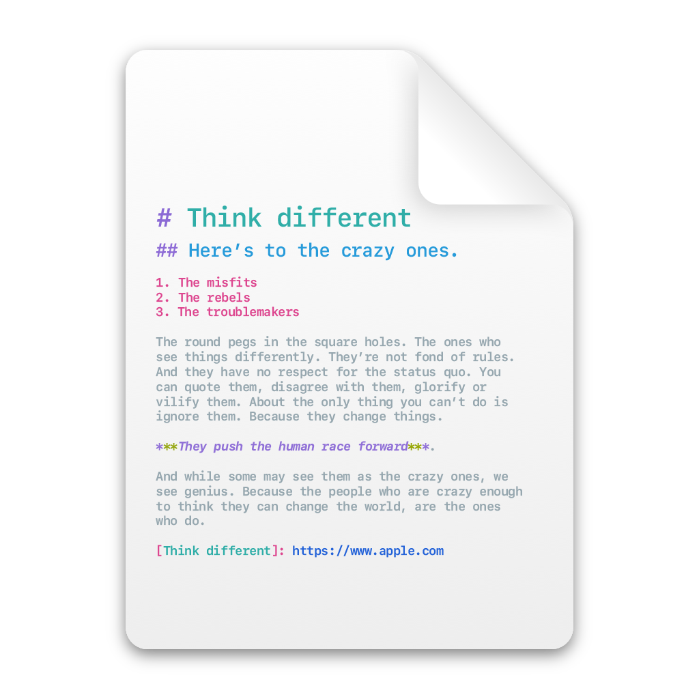

<div align="center">



<h1>Claude Clone</h1>

</div>

claude-clone makes a second, isolated copy of Claude Desktop, so you can stay signed in to two accounts at once (for example work and personal).

The clone is a separate app (`/Applications/<Name>.app`) with its own bundle ID and its own data folder (`~/Library/Application Support/<slug>`). A colored label badge on its icon tells the two apart.

## Features

- Separate app and bundle ID, so macOS treats the clone as its own app.
- Separate data folder, so each copy has its own account.
- Colored label badge on the icon, including non-Latin text.
- The original Claude.app is never modified.
- Safe to re-run after updates: the existing clone is replaced and account data is kept.
- Built-in macOS tools only, no dependencies.

## Requirements

- macOS
- Claude Desktop installed in `/Applications`
- An admin user (write access to `/Applications`)
- [Homebrew](https://brew.sh) (for `brew install`)

## Install

```sh
brew tap haric655/claude-clone
brew trust haric655/claude-clone
brew install claude-clone
```

Homebrew 7 refuses formulae from third-party taps until you trust them, hence `brew trust`.

Latest `main` instead of the tagged release:

```sh
brew install --HEAD claude-clone
```

Upgrade: `brew upgrade claude-clone`.

## Usage

Interactive:

```text
$ claude-clone
[1/3] App name [Claude Personal]:
[2/3] Icon label [Personal] (- keeps the original icon):
[3/3] Badge color (hex) [#1F2937]:
```

A summary is shown, then `Continue? [y/N]` asks for confirmation.

Non-interactive:

```sh
claude-clone --name "Claude Work" --label "Work" --color "#2E7D32" --yes
```

Use `--label -` to keep the original icon:

```sh
claude-clone --name "Claude Work" --label - --yes
```

| Flag | Description | Default |
| --- | --- | --- |
| `--name NAME` | App name | `Claude Personal` |
| `--label LABEL` | Icon label (`-` keeps the original icon) | name without "Claude" |
| `--color HEX` | Badge color, with or without `#` | `#1F2937` |
| `--source PATH` | App to copy | `/Applications/Claude.app` |
| `--yes` | Skip the confirmation | |
| `--version` | Print the version | |
| `--help` | Show help | |

The slug is the name with spaces turned into hyphens and anything outside `[A-Za-z0-9-]` removed (`Claude Test` becomes `Claude-Test`).

Running it again with the same name replaces the existing clone (only if it is a clone) and keeps the account data.

## How it works

1. Copies the app with `ditto`.
2. Edits `Info.plist`: sets the display name and the bundle ID `com.anthropic.claude.clone.<slug>`. `CFBundleName` is kept, because Electron locates its helper apps by it.
3. Draws the icon badge with JXA/AppKit, then builds the icon with `sips` and `iconutil`.
4. Replaces the executable with a wrapper that adds `--user-data-dir`, giving the clone its own data folder.
5. Re-signs ad-hoc, inside-out (never `codesign --deep`), and verifies the signature.
6. Refreshes Launch Services and the Dock.

## After a Claude update

The clone is a copy of the old version. Re-run the same command to refresh it. Account data in `~/Library/Application Support/<slug>` is kept.

## First sign-in

> [!IMPORTANT]
> Quit the original Claude before signing in to the clone. Sign-in completes through a `claude://` deep link, which goes to whichever Claude app is running or registered.

## Uninstall

Remove the clone:

```sh
rm -rf "/Applications/<Name>.app"
```

Remove the tool:

```sh
brew uninstall claude-clone
```

> [!WARNING]
> Deleting `~/Library/Application Support/<slug>` is manual and optional. It deletes that account's local data.

## Troubleshooting

**Signing errors, "app is damaged", "unable to find helper app".** Re-run claude-clone: it re-signs inside-out, without `--deep`. Do not edit `CFBundleName` in the clone: Electron finds its helper apps by that name. Check the result:

```sh
codesign --verify --deep --strict "/Applications/<Name>.app"
```

Never re-sign manually with `codesign --deep`.

**Icon did not update.** Restart the Dock and re-register the app:

```sh
killall Dock
/System/Library/Frameworks/CoreServices.framework/Frameworks/LaunchServices.framework/Support/lsregister -f "/Applications/<Name>.app"
```

Or `touch "/Applications/<Name>.app"`.

**Sign-in landed in the wrong window.** Quit all Claude apps, open only the clone, and sign in again.

**macOS shows "access to data from other apps was blocked" for the clone.** The clone is ad-hoc signed, so macOS treats it as a different app than the original, and its app data protection may block access to other apps' data. The clone keeps working. You can review this in System Settings → Privacy & Security.

## FAQ

**Can I make more than two copies?** Yes. Use a different `--name` for each.

**Is my data shared between copies?** No. Each copy has its own `--user-data-dir`.

**Does it auto-update?** No. Claude's auto-update inside the clone may not work. Update the original, then re-run claude-clone.

## Disclaimer

This is an unofficial modification. It is not affiliated with, endorsed by, or supported by Anthropic. "Claude" is a trademark of Anthropic. The copy is ad-hoc signed. Use at your own risk.

## License

[MIT](LICENSE)
